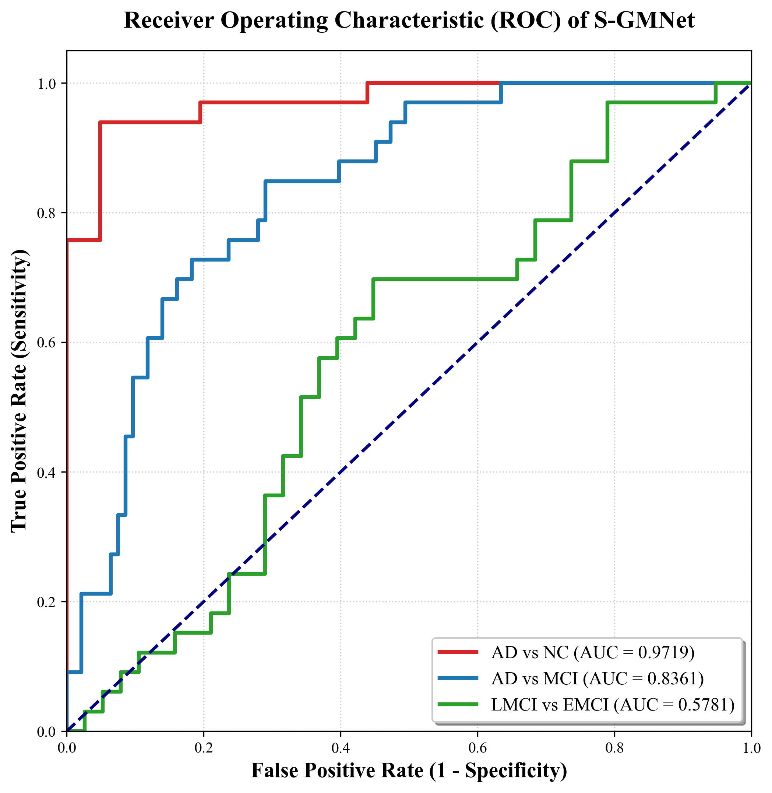
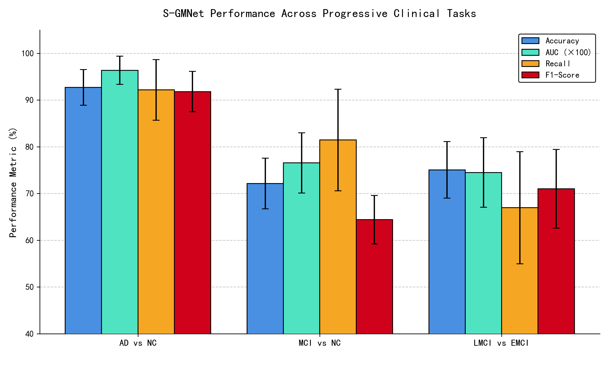
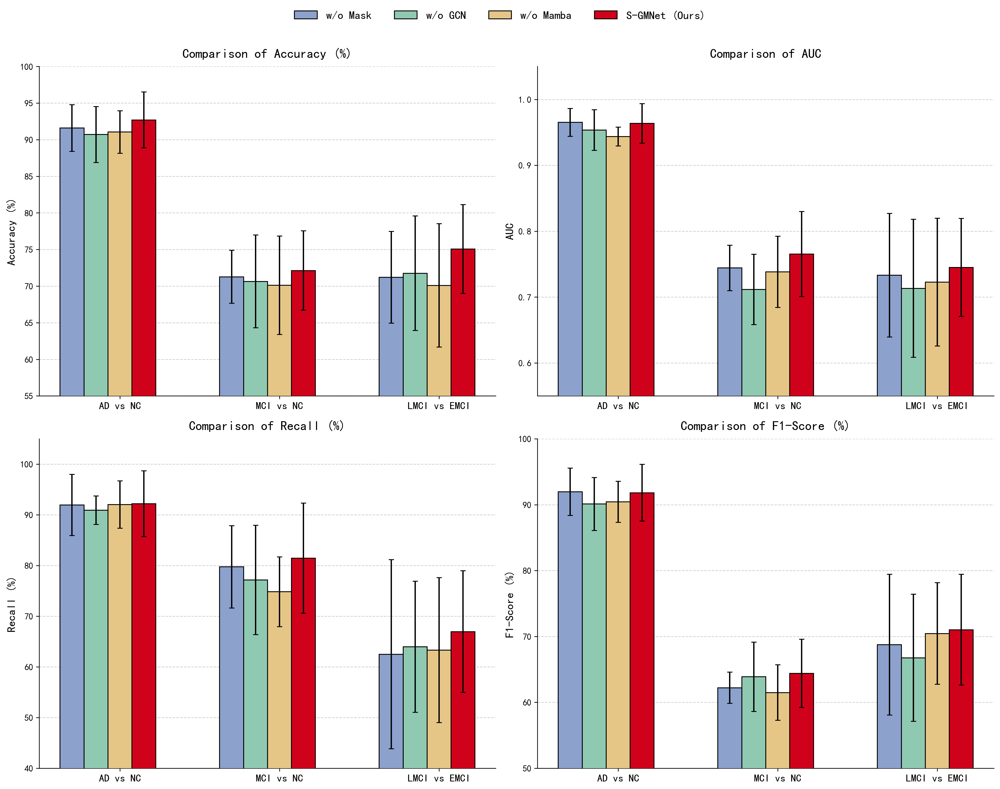
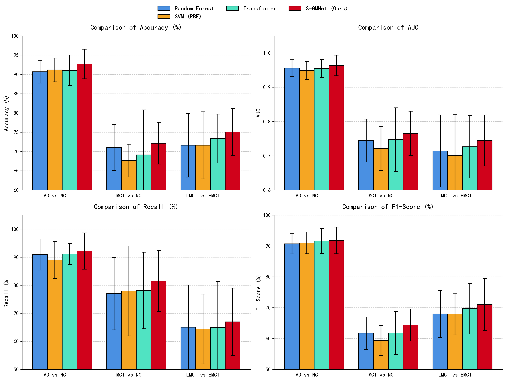
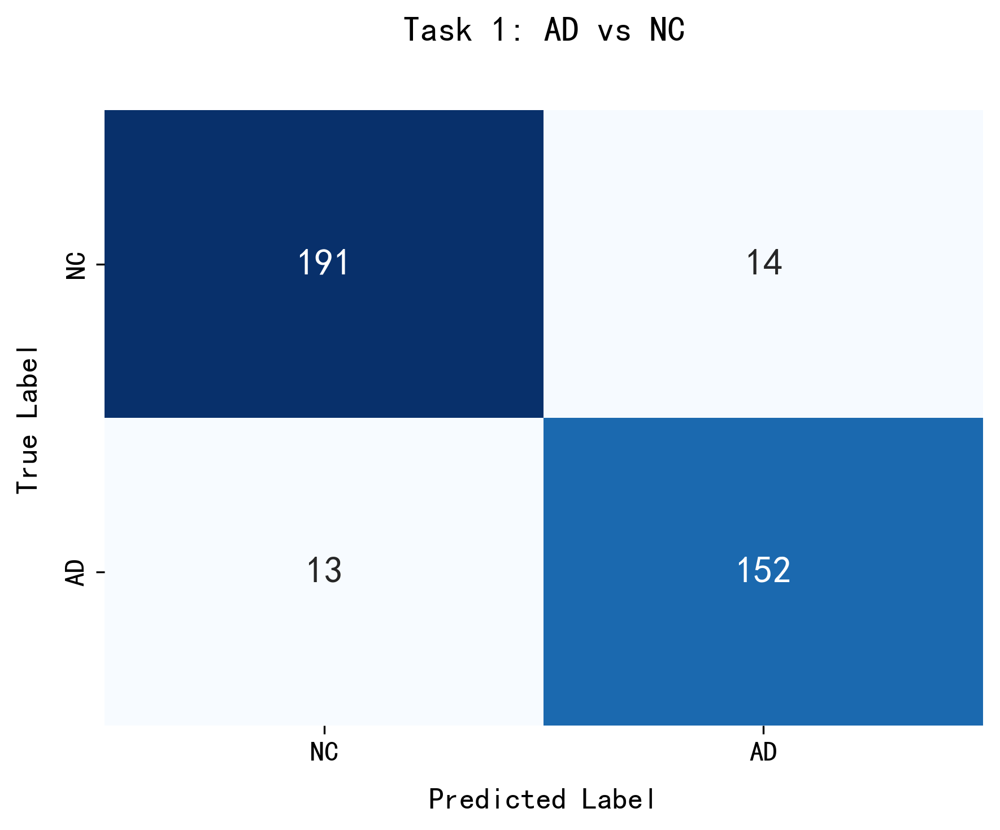
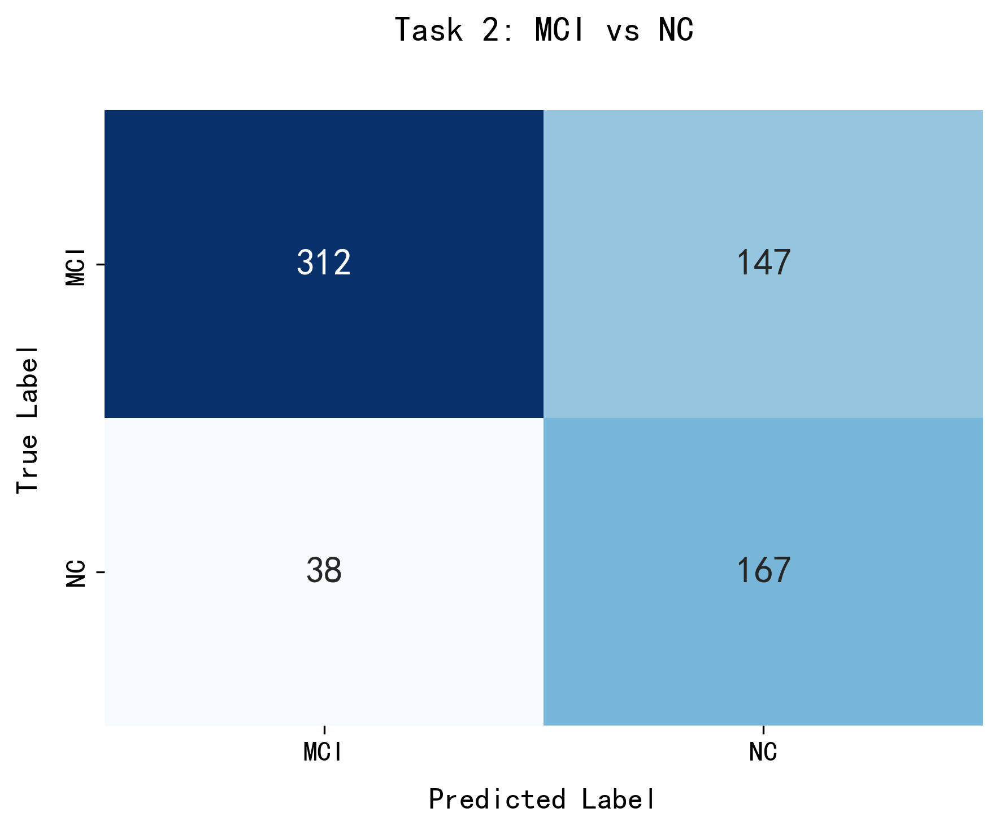
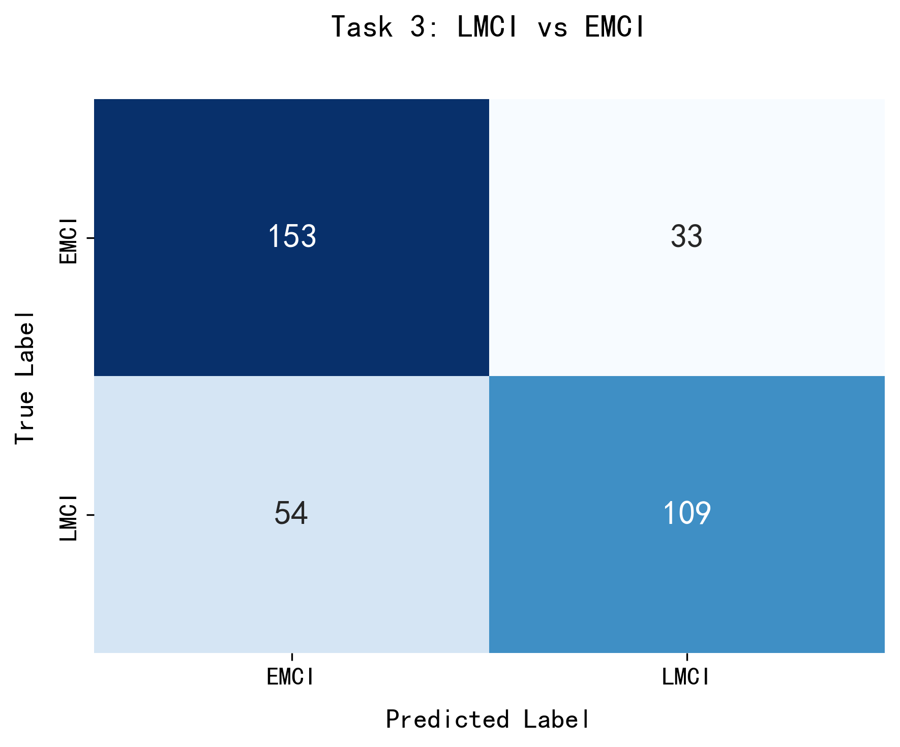
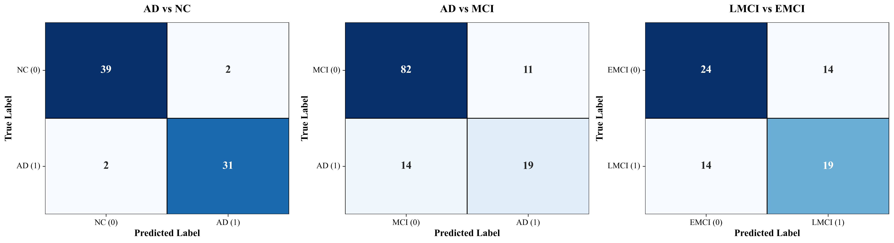

# 基于多组学数据的阿尔茨海默病早期智能诊断（S-GMNet）


面向阿尔茨海默病（AD）早期诊断，把 MRI 影像组学、脑脊液蛋白、SNP 基因与临床信息拼接成 250 维多组学特征，提出 **S-GMNet（Sparse-Mask GCN-Mamba Network）**：用可学习的稀疏掩码过滤长尾噪声并筛出候选生物标志物，用动态图卷积建立特征间的拓扑关联，用 Mamba 状态空间模型以线性复杂度完成全局依赖建模。在 ADNI 数据的三个临床二分类任务上完成十折交叉验证，并与传统机器学习、Transformer 及逐模块消融做了对照。

---

## 结果速览

十折交叉验证（分层抽样，每折独立做 SMOTE 与标准化，按验证集 AUC 选模型，Youden 指数定阈值）：

| 任务 | 样本数 | Accuracy | AUC | Precision | Recall | F1 |
| --- | --- | --- | --- | --- | --- | --- |
| AD vs NC | 370 | **92.70 ± 3.83%** | **0.9636 ± 0.0300** | 92.04% | 92.17% | 91.81% |
| NC vs MCI（合并 EMCI/LMCI） | 624 | **78.52 ± 4.70%** | **0.8070 ± 0.0368** | 60.08% | 77.61% | 65.73% |
| LMCI vs EMCI | 349 | **75.06 ± 6.06%** | **0.7449 ± 0.0744** | 79.03% | 66.95% | 71.01% |

| ROC 曲线 | 三任务指标对比 |
| --- | --- |
|  |  |

> 论文摘要中 NC vs MCI 的 AUC 记为 0.7654，那是较早一版的实验结果；本仓库实验日志（`docs/results/十折交叉验证结果.docx`）中的最终版本为 0.8070，差异来自后续对掩码极化与阈值策略的调整。

---

## 数据集

数据来自 **ADNI**（Alzheimer's Disease Neuroimaging Initiative）的 ADNI-1 / ADNI-2 / ADNI-GO 三个队列，按临床诊断分为五组：

| 标签 | 数量 | 性别（男/女） |
| --- | --- | --- |
| NC（认知正常） | 205 | 111 / 94 |
| AD（阿尔茨海默病） | 165 | 94 / 71 |
| MCI（轻度认知障碍） | 110 | 65 / 45 |
| EMCI（早期 MCI） | 186 | 101 / 85 |
| LMCI（晚期 MCI） | 163 | 94 / 69 |

特征共 **250 维**，覆盖四类模态：

- **MRI 影像组学**：SPM8 完成 AC-PC 重定位、配准、颅骨剥离与分割，按 AAL 模板取 116 个灰质脑区后剔除 26 个小脑区域，保留 **90 个 ROI** 的体积/测量值；
- **CSF 蛋白**：Aβ（ABETA）、总 tau（TAU）、磷酸化 tau（PTAU），两次测定取均值；
- **SNP 基因**：PLINK 质控（缺失率 > 2% 剔除、MAF < 5% 剔除、HWE 检验、杂合率与亲缘校正）后保留的位点；
- **临床**：年龄、性别等混杂因素。

**原始数据不随仓库提供**：ADNI 为受数据使用协议（DUA）约束的受控访问数据库，受试者级数据不得公开再分发。申请方式见 `code/data/README.md`。

---

## 方法

### 整体结构

```
多组学拼接 (B × D, D=250)
   │
   ├─ ① 稀疏掩码特征极化   M = sigmoid(mask / τ),  x' = x ⊙ M      ← L1 稀疏约束
   │
   ├─ ② 动态图卷积          A = softmax(ReLU(W_a x · xᵀ)),  H = Â X W
   │
   ├─ ③ Mamba 序列扫描      O(N) 线性复杂度的选择性状态空间建模
   │
   └─ ④ 分类头             Linear → BN → GELU → Dropout(0.6) → Linear(2)
```

### ① 稀疏掩码（Sparse Mask）

每个特征一个可学习权重，经温度缩放后的 Sigmoid 极化为近似 0/1 的门控：

```python
mask_weight = torch.sigmoid(self.mask / 0.1)   # τ = 0.1
x_filtered  = x * mask_weight
```

τ 越小越接近硬选择，训练中相当于从"软注意力"退火到"硬过滤"；配合损失里的 L1 项（`λ·mean(|M|)`，λ = 0.01）把冗余维度压向 0，只有对分类真正有贡献的特征能保持高激活——这也正是 Top-10 生物标志物的来源。

### ② 动态图卷积（DynamicGCN）

不依赖任何先验的物理连边，而是用输入自身算注意力邻接矩阵，再据此聚合信息并加残差：

```python
adj = softmax(W_a(x) @ xᵀ / sqrt(d))     # 数据驱动的动态拓扑
out = W_g(adj @ x)
return LayerNorm(x + relu(out))
```

这样基因与蛋白等异质节点之间可以学到隐式的上位效应（epistasis）。

### ③ Mamba 块

手写实现的选择性状态空间扫描：输入投影后分两路，一路经深度可分离 Conv1d 与 SiLU，再由 `x_proj` 预测 Δ、B、C，按 `h = h·exp(-Δ) + Δ·x·B` 递推，输出 `y = (h·C).sum(-1)`，最后与门控分支相乘。复杂度随序列长度**线性**增长，避免 Transformer 在小样本医疗数据上的二次方开销与注意力涣散。

### 训练配置

| 项目 | 设置 |
| --- | --- |
| 验证策略 | 分层十折交叉验证（`StratifiedKFold`, shuffle, seed 42） |
| 重采样 | 每折训练集 SMOTE 过采样 |
| 标准化 | 每折独立 `StandardScaler`（只在训练折上 fit） |
| 优化器 | Adam，lr = 1e-3，weight_decay = 0.02 |
| 学习率调度 | `StepLR(step_size=15, gamma=0.5)` |
| 训练轮数 / 批大小 | 60 / 32 |
| 损失函数 | Focal Loss（α = 0.5, γ = 2.0）+ λ·L1(掩码) |
| 模型选择 | 验证集 AUC 最高的 epoch |
| 判决阈值 | Youden 指数（max TPR−FPR）确定的动态阈值 |
| 嵌入维度 | d_model = 16，Mamba d_state = 16、expand = 2 |

---

## 实验对照

### 与传统机器学习比较

| 任务 | 模型 | Accuracy | AUC | Recall | F1 |
| --- | --- | --- | --- | --- | --- |
| AD vs NC | Random Forest | 90.70 ± 2.97 | 0.9556 | 90.92 | 90.72 |
| | SVM (RBF) | 91.16 ± 3.07 | 0.9491 | 89.04 | 91.00 |
| | **S-GMNet** | **92.70 ± 3.83** | **0.9636** | **92.17** | **91.81** |
| NC vs MCI | Random Forest | 74.68 ± 5.22 | 0.7855 | 76.04 | 62.80 |
| | SVM (RBF) | 73.91 ± 8.55 | 0.7757 | 75.66 | 61.13 |
| | **S-GMNet** | **78.52 ± 4.70** | **0.8070** | **77.61** | **65.73** |
| LMCI vs EMCI | Random Forest | 71.61 ± 8.25 | 0.7139 | 65.00 | 67.96 |
| | SVM (RBF) | 71.61 ± 8.69 | 0.7009 | 64.39 | 67.92 |
| | **S-GMNet** | **75.06 ± 6.06** | **0.7449** | **66.95** | **71.01** |

### 与 Transformer 变体比较

保持其余结构不变、仅把 Mamba 块换成 Transformer：

| 任务 | Transformer | S-GMNet |
| --- | --- | --- |
| AD vs NC | Acc 91.05 / AUC 0.9543 | Acc 92.70 / AUC 0.9636 |
| NC vs MCI | Acc 76.12 / AUC 0.7976 | Acc 78.52 / AUC 0.8070 |
| LMCI vs EMCI | Acc 73.34 / AUC 0.7266 | Acc 75.06 / AUC 0.7449 |

| 消融 + Transformer 对照 | 基线对比 |
| --- | --- |
|  |  |

### 消融实验

| 任务 | 变体 | Accuracy | AUC | Recall | F1 |
| --- | --- | --- | --- | --- | --- |
| AD vs NC | w/o Mask | 91.59 ± 3.20 | 0.9651 | 91.93 | 91.96 |
| | w/o GCN | 90.70 ± 3.83 | 0.9535 | 90.90 | 90.10 |
| | w/o Mamba | 91.05 ± 2.91 | 0.9437 | 92.01 | 90.43 |
| NC vs MCI | w/o Mask | 74.37 ± 3.90 | 0.7934 | 76.73 | 64.20 |
| | w/o GCN | 75.66 ± 6.73 | 0.8011 | 75.68 | 63.55 |
| | w/o Mamba | 76.45 ± 3.21 | 0.7968 | 77.37 | 64.75 |
| LMCI vs EMCI | w/o Mask | 71.21 ± 6.26 | 0.7332 | 62.49 | 68.74 |
| | w/o GCN | 71.76 ± 7.83 | 0.7133 | 63.96 | 66.76 |
| | w/o Mamba | 70.10 ± 8.43 | 0.7228 | 63.30 | 70.45 |

**一个诚实的观察**：在 AD vs NC 上，去掉稀疏掩码后 AUC 反而略高（0.9651 vs 0.9636），说明掩码带来的收益主要体现在**可解释性与特征筛选**，而非该任务上的分类精度；GCN 与 Mamba 的移除在三个任务上则一致造成下降，其中 LMCI vs EMCI 最明显（AUC 0.7449 → 0.71~0.73）。

---

## 提取的生物标志物

以 AD vs NC 任务为例，十折平均掩码权重最高的 10 个特征：

| 排名 | 特征 | 权重 | 说明 |
| --- | --- | --- | --- |
| 1 | TAU | 0.8330 | 总 tau 蛋白 |
| 2 | ABETA | 0.8245 | β-淀粉样蛋白 |
| 3 | rs4575098 | 0.7856 | SNP |
| 4 | rs3764650 | 0.7744 | SNP（ABCA7，公认 AD 风险位点） |
| 5 | rs10172113 | 0.7714 | SNP |
| 6 | rs10061074 | 0.7661 | SNP |
| 7 | rs17125439 | 0.7599 | SNP |
| 8 | 66 | 0.7415 | ROI 序号（AAL90 第 66 区） |
| 9 | 52 | 0.7364 | ROI 序号（AAL90 第 52 区） |
| 10 | rs2075650 | 0.7354 | SNP（TOMM40 / APOE 区域，公认 AD 风险位点） |

模型在没有任何基因先验输入的情况下，把 **TAU / ABETA 两个核心病理蛋白**排在前两位，并筛出了 **rs3764650（ABCA7）**、**rs2075650（TOMM40/APOE）** 这两个已被 GWAS 反复验证的 AD 风险位点——这是这套可解释性设计最有说服力的地方。

| 三任务混淆矩阵 | |
| --- | --- |
|  |  |
|  |  |

---

## 目录结构

```
alzheimer-multimodal-sgnet/
├── code/
│   ├── data_process.py             # SNP 个体内插值、缺失统计、按组 8:2 划分
│   ├── data/README.md              # 数据放置说明（ADNI 受控访问）
│   ├── single_split/               # 8:2 单次划分的三个任务训练脚本 + 评估/绘图
│   │   ├── train_ad_vs_nc.py
│   │   ├── train_ad_vs_mci.py
│   │   ├── train_lmci_vs_emci.py
│   │   ├── evaluate_model.py
│   │   └── plot_metrics.py
│   ├── ten_fold_cv/
│   │   └── tenfolds_ad_vs_mci.py   # 十折交叉验证（顶部 TASK_TYPE 切换三个任务）
│   ├── ablation/
│   │   ├── ablation_experiment.py  # w/o Mask / w/o GCN / w/o Mamba
│   │   └── transformer_variant.py  # Mamba → Transformer 对照
│   ├── machine_learning/
│   │   └── machine_learning.py     # Random Forest / SVM(RBF) 基线
│   └── plotting/                   # 论文插图脚本（对比图、混淆矩阵、消融图）
├── figures/                        # README 与论文用的结果图
├── docs/
│   ├── thesis/                     # 毕业论文（PDF + DOCX）
│   ├── slides/                     # 毕业答辩、预答辩 PPT 与讲稿
│   ├── results/                    # 十折、消融、机器学习、总体实验结果
│   ├── weekly/                     # 研究周报
│   └── 开题报告.doc
└── requirements.txt
```

> 原工程目录 `no_ten_folds` / `ten_folds` / `消融实验` / `机器学习` / `图表` 在本仓库中分别改为 `single_split` / `ten_fold_cv` / `ablation` / `machine_learning` / `plotting`，脚本逻辑未改动；`消融实验/xiaorong_exp.py` → `ablation/ablation_experiment.py`，`transformer.py` → `transformer_variant.py`。

---

## 快速开始

```bash
pip install -r requirements.txt
```

**1. 准备数据**（详见 `code/data/README.md`）

把 ADNI 导出的多组学表放到 `code/data/三模态信息总表.xlsx`，按 `NC / AD / MCI / EMCI / LMCI` 五个 sheet 组织；第 99 列起为 SNP。

**2. 数据预处理**

```bash
python code/data_process.py
```

产出 `data/` 下的插值后数据、缺失值报告、8:2 划分的训练/测试集。

**3. 训练与评估**

```bash
# 8:2 单次划分（在脚本所在目录运行，权重会写在该目录）
cd code/single_split
python train_ad_vs_nc.py

# 十折交叉验证（顶部 TASK_TYPE：1=AD vs NC，2=MCI vs NC，3=LMCI vs EMCI）
cd code/ten_fold_cv
python tenfolds_ad_vs_mci.py

# 消融 / Transformer 对照 / 传统机器学习基线
cd code/ablation        && python ablation_experiment.py
cd code/ablation        && python transformer_variant.py
cd code/machine_learning && python machine_learning.py
```

> 原代码把数据路径硬编码为 `C:\Users\14163\Desktop\code\design\data`，克隆后无法运行；本仓库已改为基于脚本位置的相对路径（指向 `code/data/`），其余逻辑保持不变。模型权重（`best_*.pth`）与图表按脚本当前工作目录输出。

---

## 局限与后续方向

- **样本量小**：三个任务分别只有 370 / 624 / 349 个样本，十折交叉验证的折间方差偏大（LMCI vs EMCI 的 AUC 标准差达 0.074），结论的稳定性有待更大规模队列验证。
- **SNP 插值方式偏强**：按个体在 SNP 维度上做线性插值，等于假设相邻位点数值连续，这与基因型的离散本质不符；更稳妥的做法是以群体众数或 LD 邻近位点填补。
- **LMCI vs EMCI 仍是最难的一关**：AUC 0.7449，召回 66.95%，说明极早期亚型边界的信号还很弱。
- **掩码的可解释性**是"重要性"而非"因果"：Top-10 位点与已知 AD 位点重合是正向证据，但仍需独立的生物学实验验证。
- 后续可尝试：多模态分别编码后再融合、引入通路先验构建图结构、外部队列（如 UK Biobank、OASIS）做外部验证。

---

## 文档

| 文件 | 说明 |
| --- | --- |
| [`docs/thesis/江浩天毕业论文.pdf`](docs/thesis/江浩天毕业论文.pdf) | 毕业论文完整版（含公式推导、图表与参考文献） |
| [`docs/slides/毕业答辩.pptx`](docs/slides/毕业答辩.pptx) | 毕业答辩幻灯片 |
| [`docs/slides/答辩稿.docx`](docs/slides/答辩稿.docx) | 答辩讲稿 |
| [`docs/results/十折交叉验证结果.docx`](docs/results/十折交叉验证结果.docx) | 十折交叉验证原始日志（含每折指标与 Top-10 标志物） |
| [`docs/results/消融实验数据.docx`](docs/results/消融实验数据.docx) | 消融实验输出 |
| [`docs/results/机器学习结果.docx`](docs/results/机器学习结果.docx) | RF / SVM 基线输出 |
| [`docs/开题报告.doc`](docs/开题报告.doc) | 开题报告 |

*本工作为本科毕业设计，模型与结论仅用于科研与教学演示，不构成任何临床诊断依据。*
